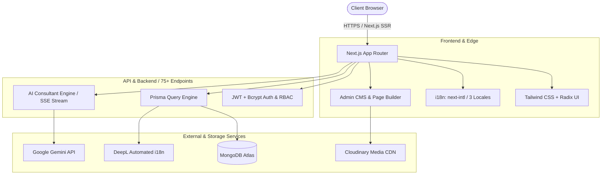
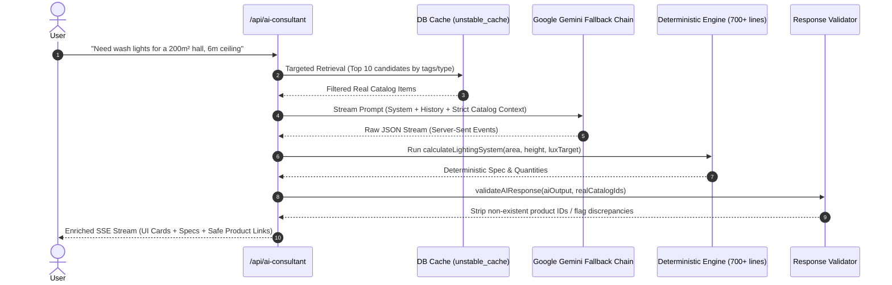

# Technical Case Study: ART-R B2B Distribution Platform & AI Consultant

**System:** ART-R (B2B/B2C Professional Lighting & Stage Equipment Distribution)  
**Live URL:** [artr.com.ua](https://artr.com.ua)  
**Role:** Sole Full-Stack Developer & Technical Designer  
**Timeline:** Early 2026 – Present  
**Stack:** Next.js 15 (App Router), React 18, TypeScript, Prisma ORM, MongoDB Atlas, Tailwind CSS, Radix UI, Google Generative AI API (Gemini), TipTap, Cloudinary, next-intl, DeepL API

---

## 1. Business Context & Challenges
ART-R is a long-standing distributor of professional concert, stage, and architectural lighting (brands like ROBE, ChamSys, Astera) founded in 1992.

### Critical Roadblocks:
1. **Catalog Overhead:** Over 650 complex SKUs with multi-voltage specs, DMX channels, and beam angles. Adding or editing products previously required developer/database intervention.
2. **Dual Audience Needs:** Retail/B2C buyers need standard retail pricing and simple carts, while 20+ verified B2B stage dealers require contract pricing, volume discounts, commercial proposal generation, and equipment rental lists.
3. **High Consultation Barrier:** Selecting stage equipment requires calculating throw distances, total wattage, and compatible fixtures. Customers overwhelmed sales managers with basic sizing questions.

---

## 2. System Architecture & Key Engineering Decisions

### Decision A: MongoDB Atlas + Prisma ORM (vs. Self-Hosted SQL)
* **Rationale:** A fast-growing catalog of stage fixtures requires dynamic JSON attributes (e.g., optical specs, DMX channel profiles, photometric charts vary drastically across lasers vs. moving heads vs. smoke machines).
* **Trade-off:** Chose MongoDB Atlas managed cloud to eliminate custom Docker database orchestration on bare-metal servers, trading strict relational foreign key joins for Prisma-level schema validation and unconstrained horizontal scaling.

### Decision B: Role-Based Pricing & Dealer Flow
* Implemented role separation (`CLIENT`, `DEALER`, `ADMIN`) with manual business approval workflows for dealer accounts.
* Prices calculate dynamically on the query layer:
  $$\text{Price}_{\text{effective}} = \text{BasePrice} \times (1 - \text{DealerDiscountPercentage})$$
  Ensures dealers see wholesale rates across carts, wishlists, and PDF quote generators without duplicating product tables.

---

## 3. Deep Dive: AI Consultant with Anti-Hallucination Guardrails

The AI consultant (`/api/ai-consultant/route.ts`) acts as an automated stage lighting sales engineer.

### Anti-Hallucination Mechanics:
1. **Targeted Context Injection:** Rather than dumping 650 items into the prompt context, `catalog-context.ts` parses intent (power, lumens, IP rating) and injects only top-match active items cached in-memory with `unstable_cache(..., { revalidate: 900 })`.
2. **Separation of Reasoning and Calculation:** Fixture wattage, beam throw distance, and luminaire counts are **never computed by the LLM**. The LLM extracts parameters (`areaM2`, `ceilingHeight`, `venueType`); a deterministic 702-line calculation engine (`calculation-engine.ts`) calculates actual equipment quantities.
3. **Server-Side Validation:** `validateAIResponse()` cross-references every recommended `productId` against valid MongoDB IDs before sending data down the SSE wire. If the LLM generates a fictional SKU, it is pruned automatically.

---

## 4. Admin Tooling & Client Autonomy
* **Visual Page Builder:** Built customizable section blocks powered by `@dnd-kit/core` and `@dnd-kit/sortable` allowing drag-and-drop reordering of banners, featured products, and media grids.
* **TipTap Rich Text Integration:** Custom extensions for formatting product manuals, embedded video previews, and downloadable tech sheets.
* **Bulk Import:** Integrated SheetJS (`xlsx`) to parse multi-column manufacturer price lists directly into validated Prisma operations, cutting catalog maintenance from hours to a few clicks.

---

## 5. Verifiable Engineering Outcomes
* **Catalog Scale:** 650+ verified production products across 75+ Next.js API routes.
* **Dealer Adoption:** 20+ registered B2B dealers using the portal for commercial proposals.
* **Localization:** 3-language complete parity (UA, RU, EN) with automated translation scripts using DeepL API.
* **Uptime & Delivery:** Live on Vercel with zero database downtime, sub-second edge routing, and automated cache revalidation.
